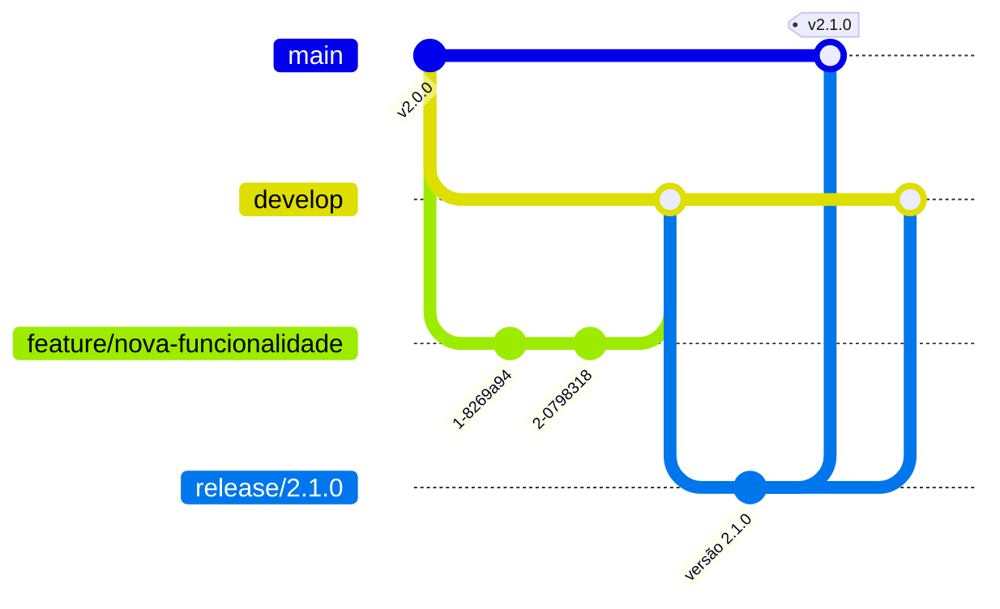

# Guia de contribuição

## Fluxo de branches (git flow)



### Nova funcionalidade

```bash
git checkout develop && git pull
git checkout -b feature/nome-curto
# ... commits ...
git push -u origin feature/nome-curto
# abra um pull request para a develop; a CI precisa passar
```

### Nova versão

```bash
git checkout -b release/X.Y.Z develop
npm version X.Y.Z --no-git-tag-version   # atualiza package.json e package-lock.json
# registre as mudanças no CHANGELOG.md e faça o commit
git checkout main && git merge --no-ff release/X.Y.Z
git checkout develop && git merge --no-ff release/X.Y.Z
git branch -d release/X.Y.Z
git push origin main develop
gh release create vX.Y.Z --target main --generate-notes   # dispara o workflow de release
```

A release também pode ser publicada pelo site: **Releases > Draft a new release**,
tag `vX.Y.Z` (criada na publicação), alvo `main` e **Generate release notes**.

### Correção urgente em produção

```bash
git checkout -b hotfix/X.Y.Z main
# ... correção e versão ...
git checkout main && git merge --no-ff hotfix/X.Y.Z
git checkout develop && git merge --no-ff hotfix/X.Y.Z
git branch -d hotfix/X.Y.Z
git push origin main develop
gh release create vX.Y.Z --target main --generate-notes
```

## Antes de abrir um pull request

```bash
npm run lint
npm run test:coverage
npm run build
```

As três verificações também rodam na CI e precisam passar.

## Padrão de código

O código segue o padrão de programação da Agiw ([docs/padroes](docs/padroes)):

- variáveis com prefixo do tipo: `s` texto, `i` inteiro, `n` decimal, `b` booleano,
  `a` vetor, `o` objeto e `dt` data (`sCodConta`, `aMovimentos`, `bConciliado`);
- funções em camelCase iniciadas por verbo e com comentário de fechamento
  (`} // nomeDaFuncao`);
- classes e componentes em PascalCase e constantes em MAIÚSCULAS;
- tabelas no formato `TBXXXX999` e colunas com prefixo do papel (`COD`, `DES`, `DAT`,
  `VAL`, `NUM`, `TIP`, `STA`, `QTD`);
- valores monetários comparados em centavos inteiros;
- validações sempre antes de iniciar a gravação.

## Mensagens de commit

Escritas em português, no imperativo, com uma primeira linha curta que diga o que
muda ("Adiciona filtro por campo na grade do banco") e, quando necessário, um corpo
explicando o porquê.
