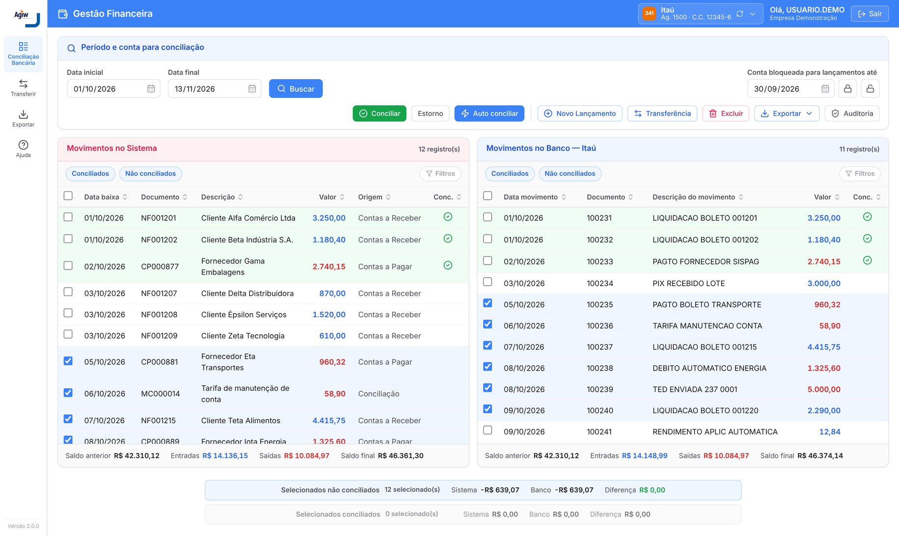
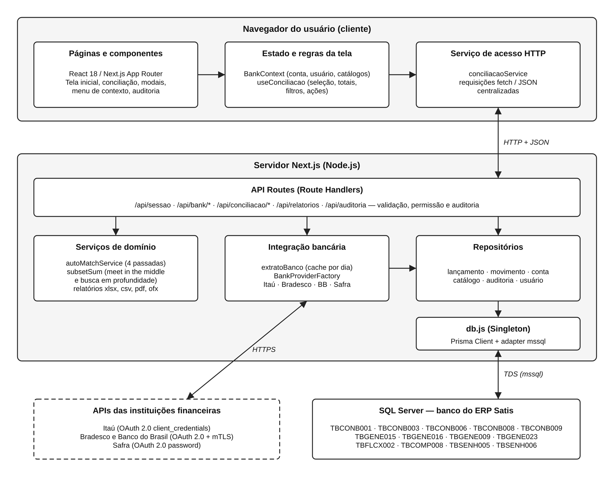
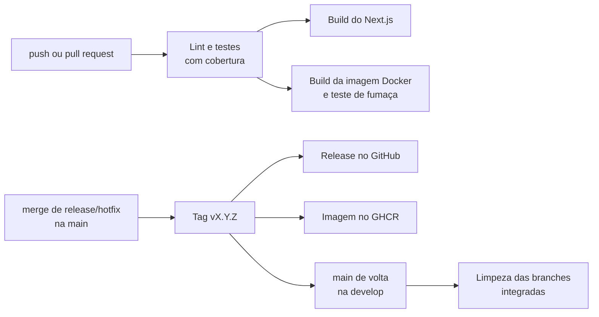

# Conciliação Bancária — Módulo Financeiro do ERP Satis

[](https://github.com/Dracon-46/PI_Agiw_Fatec/actions/workflows/ci.yml)


Projeto Integrador II do curso de **Análise e Desenvolvimento de Sistemas (AMS)** da
**Fatec Sorocaba**, desenvolvido em parceria com a **Agiw Sistemas** (Ticket 37060 —
Projeto Banco).

O módulo confronta, em uma única tela, os lançamentos registrados no ERP Satis com o
extrato obtido **diretamente das APIs dos bancos**, e permite conciliar de forma manual
ou automática, estornar, lançar tarifas, transferir entre contas, bloquear períodos já
conferidos, exportar relatórios e auditar tudo o que foi feito.



---

## Sumário

- [Funcionalidades](#funcionalidades)
- [Arquitetura](#arquitetura)
- [Tecnologias](#tecnologias)
- [Como executar](#como-executar)
- [Testes e qualidade](#testes-e-qualidade)
- [CI/CD](#cicd)
- [Fluxo de trabalho (git flow)](#fluxo-de-trabalho-git-flow)
- [Integrações bancárias](#integrações-bancárias)
- [Estrutura do repositório](#estrutura-do-repositório)
- [Documentação](#documentação)
- [Segurança](#segurança)
- [Equipe](#equipe)

---

## Funcionalidades

Cada funcionalidade atende um item do [Documento de Visão](docs/requisitos/Documento_de_Visao_Projeto_Banco.pdf).

| Item | Funcionalidade |
| --- | --- |
| 6.1.1 | Tela inicial com um cartão por conta corrente: banco, agência, saldo previsto e data do último bloqueio |
| 6.1.2 | Extrato do sistema e extrato do banco lado a lado, com saldo anterior, entradas, saídas e saldo final |
| 6.1.3.1 | Bloqueio e desbloqueio de período, com permissão conferida no servidor |
| 6.1.3.2 | Período sugerido automaticamente: último bloqueio + 1 até ontem (máximo de 60 dias) |
| 6.1.3.3 | Importação do extrato pela API do banco, consultando apenas os dias ainda não lidos |
| 6.1.3.4 | Filtros de situação (conciliado / não conciliado) e filtro combinável por qualquer campo |
| 6.1.3.5 | Seleção sem misturar status e somatórias em duas linhas, com a diferença |
| 6.1.3.6 / 6.1.3.7 | Conciliar e estornar somente com diferença zero |
| 6.1.3.8 | Menu do botão direito: novo lançamento, transferência entre contas e exclusão |
| 6.2 | Relatórios em Excel, PDF, CSV e OFX com saldos e totais |
| — | **Conciliação automática** 1:1, N:1, 1:N e N:N por soma de subconjuntos |
| — | Trilha de auditoria de todas as ações do módulo |

A conciliação automática trata o caso de um movimento do banco que corresponde à soma de
vários lançamentos como o problema da **soma de subconjuntos** (*Subset Sum*): até 36
candidatos a busca é exata, pela técnica *meet in the middle*; acima disso, uma busca em
profundidade com prazo informa quando foi interrompida. Os valores são comparados em
centavos inteiros, nunca em ponto flutuante.

---

## Arquitetura



O módulo é uma aplicação **Next.js** em camadas. No navegador ficam as páginas React, o
estado da tela (`BankContext` e `useConciliacao`) e um único serviço HTTP; no servidor
ficam as rotas da API, os serviços de domínio, a integração bancária e os repositórios.
Nenhum componente acessa o banco de dados ou as APIs dos bancos diretamente: credenciais
e certificados nunca chegam ao navegador.

O módulo **não tem banco próprio**: trabalha dentro do SQL Server do ERP Satis, sobre as
tabelas que o ERP já usa. Só duas tabelas foram criadas, porque não tinham equivalente:
`TBCONB008` (dias de extrato já consultados) e `TBCONB009` (auditoria).

| Padrão de projeto | Onde |
| --- | --- |
| Strategy + Template Method | `BankProvider` e um provider por banco |
| Factory | `BankProviderFactory`, com uma instância por banco para preservar o token |
| Adapter | normalização das respostas de cada API para um formato único de movimento |
| Repository | `src/lib/repositories/`, um arquivo por tabela/agregado do ERP |
| Singleton | `src/lib/db.js`, um único cliente Prisma por processo |
| Facade | `conciliacaoService`, que centraliza as chamadas HTTP do navegador |

Os diagramas de casos de uso, classes, atividades e o modelo de dados estão em
[`docs/diagramas`](docs/diagramas).

---

## Tecnologias

| Camada | Tecnologia |
| --- | --- |
| Interface | Next.js 14 (App Router) + React 18 |
| API | Route Handlers do Next.js (Node.js 20) |
| Banco de dados | Microsoft SQL Server do ERP, via Prisma 7 + adapter `mssql` |
| Relatórios | ExcelJS (xlsx), CSV, HTML de impressão (PDF) e OFX |
| Testes | Vitest + cobertura V8 |
| Qualidade | ESLint (`next/core-web-vitals`) e EditorConfig |
| Contêiner | Docker multi-stage (Next.js standalone) e Docker Compose |
| CI/CD | GitHub Actions, GitHub Container Registry e Dependabot |

---

## Como executar

### Pré-requisitos

- Node.js 20 (há um `.nvmrc` na raiz)
- Acesso a um SQL Server com o banco do ERP Satis (`BDAPRESENTACAO`)
- Credenciais de desenvolvedor dos bancos a integrar e, para Bradesco e Banco do Brasil,
  o certificado de cliente exigido pelo mTLS (colocado em `certs/`)

### Localmente

```bash
npm install                 # instala as dependências e gera o cliente do Prisma
cp .env.example .env        # preencha DB_* e as credenciais dos bancos
npm run db:init             # cria TBCONB008 e TBCONB009 (não altera o ERP)
npm run dev                 # http://localhost:3000
```

Para produção: `npm run build` e `npm start`.

### Com Docker

```bash
cp .env.example .env        # aponte DB_SERVER para o SQL Server do ERP
docker compose up -d --build
curl http://localhost:3000/api/health        # aplicação no ar
curl http://localhost:3000/api/health?db=1   # aplicação e banco de dados
```

A imagem roda com usuário sem privilégios, tem `HEALTHCHECK` e recebe os certificados
de `certs/` como volume somente leitura.

### Scripts

| Comando | O que faz |
| --- | --- |
| `npm run dev` | Servidor de desenvolvimento |
| `npm run build` / `npm start` | Build e execução de produção |
| `npm run lint` | ESLint em `src`, `scripts` e `tests` |
| `npm test` | Testes automatizados |
| `npm run test:coverage` | Testes com relatório de cobertura em `coverage/` |
| `npm run db:init` | Confere as tabelas do ERP e cria as duas tabelas do módulo |
| `npm run db:extrato` | Carrega antecipadamente o extrato das contas configuradas |
| `npm run db:espelho` | Gera a massa de homologação espelhando o extrato importado |
| `npm run diag:itau` · `diag:bradesco` · `diag:bb` · `diag:safra` | Diagnóstico ponta a ponta de cada integração: configuração, token e extrato |

---

## Testes e qualidade

```bash
npm run lint
npm run test:coverage
```

São 75 testes automatizados, entre unitários e de integração:

- algoritmo de soma de subconjuntos, inclusive com alvo próximo de R$ 1 milhão e
  interrupção por prazo;
- as quatro passadas da conciliação automática;
- regras de período, datas, valores, rateio por centro de custo e subgrupos;
- adaptadores do Banco do Brasil e do Bradesco e a factory de providers;
- cache do extrato por dia e geração de CSV, OFX e Excel;
- rotas `/api/conciliacao/conciliar` e `/api/health`, com os repositórios simulados.

A cobertura das regras de negócio fica acima de 85% e a pipeline falha se ela cair
abaixo desse limite.

---

## CI/CD



- **[CI](.github/workflows/ci.yml)** — roda em todo push das branches do git flow e em
  todo pull request para `develop` e `main`: lint, testes com cobertura (publicada como
  artefato), build de produção e build da imagem Docker, que é iniciada e testada no
  `/api/health`.
- **[Release](.github/workflows/release.yml)** — a cada push na `main` (merge de uma
  `release/*` ou `hotfix/*`), cria a tag da versão do `package.json`, a release com as
  notas geradas, publica a imagem em `ghcr.io/dracon-46/pi_agiw_fatec`, traz a `main`
  de volta para a `develop` e apaga as branches já integradas. Nenhuma tag é criada à
  mão.
- **[Dependabot](.github/dependabot.yml)** — abre PRs de atualização para a `develop`;
  trocas de versão principal do Next.js, React e ESLint ficam de fora, porque exigem
  migração planejada.

---

## Fluxo de trabalho (git flow)

| Branch | Uso |
| --- | --- |
| `main` | Código em produção. Só recebe merges de `release/*` e `hotfix/*`; a tag de versão é criada pela pipeline |
| `develop` | Integração das funcionalidades prontas |
| `feature/<nome>` | Uma funcionalidade, criada a partir da `develop` e integrada nela |
| `release/<versão>` | Preparação de uma versão, da `develop` para a `main` |
| `hotfix/<versão>` | Correção urgente, da `main` para a `main` e a `develop` |

As versões seguem o [versionamento semântico](https://semver.org/lang/pt-BR/) e estão
descritas no [CHANGELOG](CHANGELOG.md). O passo a passo está no
[guia de contribuição](CONTRIBUTING.md).

---

## Integrações bancárias

Cada banco é uma classe que estende `BankProvider` e é registrada na
`BankProviderFactory`; incluir um banco novo não altera os existentes.

| Banco | Autenticação | Situação |
| --- | --- | --- |
| Itaú | OAuth 2.0 *client credentials* | Extrato da carteira de cobrança obtido no sandbox |
| Bradesco | OAuth 2.0 + mTLS | Extrato de conta corrente obtido com certificado de cliente |
| Banco do Brasil | OAuth 2.0 + mTLS no extrato | Autenticação validada; extrato depende do certificado e-CNPJ |
| Safra | OAuth 2.0 *password* | Autenticação validada; extrato depende da contratação do produto |

---

## Estrutura do repositório

```
.
├── .github/              workflows de CI/CD, Dependabot e template de PR
├── certs/                certificados mTLS (fora do Git)
├── database/schema.sql   DDL das duas tabelas do módulo
├── docs/                 monografia, requisitos, atas, padrões, diagramas e telas
├── prisma/               esquema do subconjunto de tabelas do ERP usado pelo módulo
├── public/               logotipos
├── scripts/              inicialização do banco, carga de extrato e diagnósticos
├── src/
│   ├── app/              páginas e rotas da API (Next.js App Router)
│   ├── components/       telas, modais, menu de contexto e campos
│   ├── contexts/         conta selecionada, usuário e catálogos
│   ├── hooks/            regras da tela de conciliação
│   ├── lib/              acesso ao banco, extrato, relatórios e repositórios
│   ├── providers/        integrações bancárias (Strategy + Factory)
│   ├── services/         cliente HTTP e conciliação automática
│   └── utils/            soma de subconjuntos, datas, valores e catálogos
├── tests/                testes unitários e de integração
├── Dockerfile
└── docker-compose.yml
```

---

## Documentação

| Pasta | Conteúdo |
| --- | --- |
| [`docs/monografia`](docs/monografia) | Monografia do Projeto Integrador (PDF e DOCX) |
| [`docs/requisitos`](docs/requisitos) | Documento de Visão e protótipo de tela fornecidos pela Agiw |
| [`docs/atas`](docs/atas) | Atas das reuniões com a empresa parceira |
| [`docs/padroes`](docs/padroes) | Padrões de programação e de interface da Agiw |
| [`docs/diagramas`](docs/diagramas) | Casos de uso, arquitetura, DER, classes e atividades |
| [`docs/telas`](docs/telas) | Capturas das telas do sistema |

---

## Segurança

- `.env`, certificados (`*.key`, `*.crt`, `*.pfx`) e kits dos bancos ficam fora do Git
- Credenciais das APIs e do banco de dados são lidas apenas no servidor
- Toda gravação valida dados, permissão (tabelas de permissão do Satis) e período
  bloqueado no servidor, antes de gravar
- O contêiner roda sem privilégios de root

---

## Equipe

| Integrante |
| --- |
| Arthur Gaspare Camzano |
| Felipe Ferreira De Souza |
| Gabriel Silva |
| Giovanni Camargo Maruccio |
| Luiz Felipe Glauser Lucas |

**Orientador:** Prof. Antonio Cesar de Barros Munari — Fatec Sorocaba
**Empresa parceira:** Agiw Sistemas
