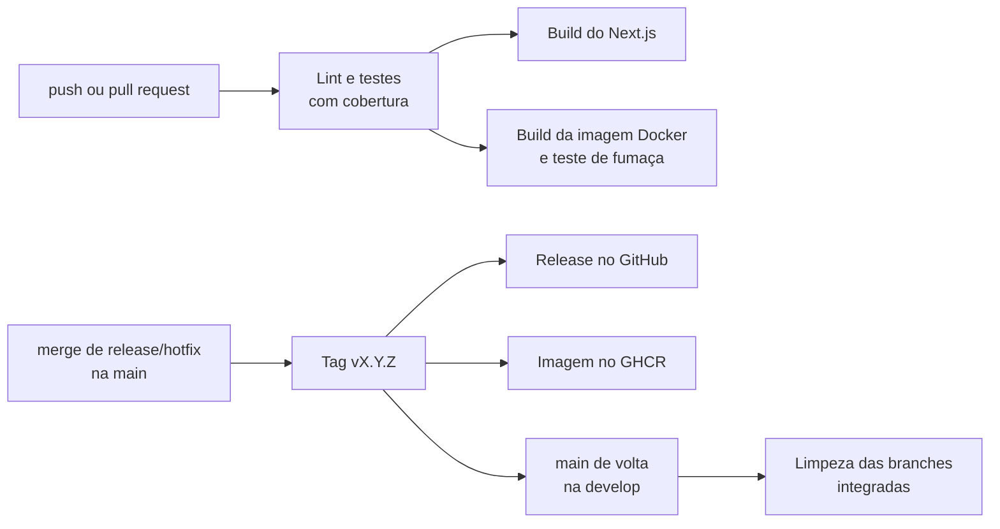

# Conciliação Bancária — Módulo Financeiro do ERP Satis

[](https://github.com/Dracon-46/PI_Agiw_Fatec/actions/workflows/ci.yml)


Projeto Integrador II do curso de **Análise e Desenvolvimento de Sistemas (AMS)** da
**Fatec Sorocaba**, desenvolvido em parceria com a **Agiw Sistemas** (Ticket 37060 —
Projeto Banco).

O módulo confronta, em uma única tela, os lançamentos registrados no ERP Satis com o
extrato obtido **diretamente das APIs dos bancos**, e permite conciliar de forma manual
ou automática, estornar, lançar tarifas, transferir entre contas, bloquear períodos já
conferidos, exportar relatórios e auditar tudo o que foi feito.

> **Projeto para execução local.** O Documento de Visão define que o módulo faz parte do
> **Satis Desktop** e que o projeto **não** é sistema web nem aplicativo móvel
> ([item 4 – Finalidade](docs/requisitos/Documento_de_Visao_Projeto_Banco.pdf)). Por isso ele
> roda na infraestrutura da própria empresa: o servidor do módulo fica na mesma rede do
> SQL Server do ERP e é acessado pelo navegador (`http://localhost:3000`), sem hospedagem
> em nuvem. Para avaliar o projeto sem a base real do ERP, siga
> [Rodar localmente com base de teste](#rodar-localmente-com-base-de-teste).


---

## Sumário

- [Funcionalidades](#funcionalidades)
- [Requisitos não funcionais definidos pelo cliente](#requisitos-não-funcionais-definidos-pelo-cliente)
- [Arquitetura](#arquitetura)
- [Tecnologias](#tecnologias)
- [Rodar localmente com base de teste](#rodar-localmente-com-base-de-teste)
- [Executar com a base do ERP e com Docker](#executar-com-a-base-do-erp-e-com-docker)
- [Testes e qualidade](#testes-e-qualidade)
- [CI/CD](#cicd)
- [Fluxo de trabalho (git flow)](#fluxo-de-trabalho-git-flow)
- [Integrações bancárias](#integrações-bancárias)
- [Estrutura do repositório](#estrutura-do-repositório)
- [Documentação](#documentação)
- [Segurança](#segurança)
- [Equipe](#equipe)

---

## Funcionalidades

Cada funcionalidade atende um item do [Documento de Visão](docs/requisitos/Documento_de_Visao_Projeto_Banco.pdf).

| Item | Funcionalidade |
| --- | --- |
| 6.1.1 | Tela inicial com um cartão por conta corrente: banco, agência, saldo previsto e data do último bloqueio |
| 6.1.2 | Extrato do sistema e extrato do banco lado a lado, com saldo anterior, entradas, saídas e saldo final |
| 6.1.3.1 | Bloqueio e desbloqueio de período, com permissão conferida no servidor |
| 6.1.3.2 | Período sugerido automaticamente: último bloqueio + 1 até ontem (máximo de 60 dias) |
| 6.1.3.3 | Importação do extrato pela API do banco, consultando apenas os dias ainda não lidos |
| 6.1.3.4 | Filtros de situação (conciliado / não conciliado) e filtro combinável por qualquer campo |
| 6.1.3.5 | Seleção sem misturar status e somatórias em duas linhas, com a diferença |
| 6.1.3.6 / 6.1.3.7 | Conciliar e estornar somente com diferença zero |
| 6.1.3.8 | Menu do botão direito: novo lançamento, transferência entre contas e exclusão |
| 6.2 | Relatórios em Excel, PDF, CSV e OFX com saldos e totais |
| — | **Conciliação automática** 1:1, N:1, 1:N e N:N por soma de subconjuntos |
| — | Trilha de auditoria de todas as ações do módulo |

A conciliação automática trata o caso de um movimento do banco que corresponde à soma de
vários lançamentos como o problema da **soma de subconjuntos** (*Subset Sum*): até 36
candidatos a busca é exata, pela técnica *meet in the middle*; acima disso, uma busca em
profundidade com prazo informa quando foi interrompida. Os valores são comparados em
centavos inteiros, nunca em ponto flutuante.

---

## Requisitos não funcionais definidos pelo cliente

Requisitos estabelecidos pela Agiw no Documento de Visão, nas atas de reunião e nos
padrões que a empresa entregou à equipe.

| # | Requisito | Fonte | Como o módulo atende |
| --- | --- | --- | --- |
| RNF01 | Execução local, integrada ao Satis Desktop; não é sistema web nem aplicativo móvel | [Documento de Visão](docs/requisitos/Documento_de_Visao_Projeto_Banco.pdf), item 4 | Roda na infraestrutura da empresa, na mesma rede do SQL Server do ERP, e é acessado pelo navegador em `localhost` |
| RNF02 | Conciliação mais **segura** e **ágil**, com conexão direta com os bancos | Documento de Visão, item 3.1 | Extrato lido pelas APIs dos bancos com OAuth 2.0 e mTLS; credenciais e certificados ficam só no servidor |
| RNF03 | Persistência no SQL Server do ERP, sobre as tabelas do Satis | Documento de Visão, item 6 (tabelas); [ata de 17/04/2026](docs/atas/Ata_Reuniao_2026-04-17.pdf) | Trabalha dentro do banco do ERP; cria apenas `TBCONB008` e `TBCONB009`, sem migrações sobre as tabelas existentes |
| RNF04 | APIs em Next.js e acesso a dados com Prisma | [ata de 28/04/2026](docs/atas/Ata_Reuniao_2026-04-28.pdf); ata de 17/04/2026 | API em Route Handlers do Next.js 14 e Prisma 7 com adapter `mssql` |
| RNF05 | Interface no padrão gráfico da Agiw: azul `#3B82F6`, tons de cinza neutros e fonte Segoe UI | [Padrão de Interface](docs/padroes/Padrao_de_Interface.pdf) | Aplicado em `src/styles/globals.css` |
| RNF06 | Código no padrão de programação da Agiw | [Padrão de Programação](docs/padroes/Padrao_de_Programacao.pdf); ata de 17/04/2026 | Prefixos de tipo, funções com verbo, comentário de fechamento e nomes de tabela e coluna do ERP (ver [CONTRIBUTING](CONTRIBUTING.md)) |
| RNF07 | Bloqueio e desbloqueio de período só com permissão de acesso, e data de bloqueio anterior à data do dia | Documento de Visão, item 6.1.3.1 | Permissões lidas das tabelas do Satis (`TBSENH005`/`TBSENH006`) e conferidas no servidor antes de gravar |
| RNF08 | Conciliar e estornar somente com diferença zero entre as somatórias | Documento de Visão, itens 6.1.3.6 e 6.1.3.7 | Valores comparados em centavos inteiros; a rota recusa a gravação com diferença |
| RNF09 | Não duplicar movimento já importado | Documento de Visão, item 6.1.3.3 | Identificador determinístico (`FITID`) por movimento; o mesmo dia não é consultado duas vezes (`TBCONB008`) |
| RNF10 | Relatórios em Excel ou PDF com saldo inicial, movimentos, saldo final e totais | Documento de Visão, item 6.2 | Exportação em Excel, PDF, CSV e OFX |
| RNF11 | Prioridade de integração: Itaú, depois Banco do Brasil; Bradesco e Safra em seguida | ata de 17/04/2026 | Os quatro bancos implementados; situação em [Integrações bancárias](#integrações-bancárias) |

A ata de 28/04/2026 também registra que a Agiw usa **Angular com PrimeNG** na interface
de novos projetos. A interface deste módulo foi feita em React (Next.js); como a API é
independente da tela, a migração para Angular com PrimeNG fica como trabalho futuro.

---

## Arquitetura


O módulo é uma aplicação **Next.js** em camadas. No navegador ficam as páginas React, o
estado da tela (`BankContext` e `useConciliacao`) e um único serviço HTTP; no servidor
ficam as rotas da API, os serviços de domínio, a integração bancária e os repositórios.
Nenhum componente acessa o banco de dados ou as APIs dos bancos diretamente: credenciais
e certificados nunca chegam ao navegador.

O módulo **não tem banco próprio**: trabalha dentro do SQL Server do ERP Satis, sobre as
tabelas que o ERP já usa. Só duas tabelas foram criadas, porque não tinham equivalente:
`TBCONB008` (dias de extrato já consultados) e `TBCONB009` (auditoria).

| Padrão de projeto | Onde |
| --- | --- |
| Strategy + Template Method | `BankProvider` e um provider por banco |
| Factory | `BankProviderFactory`, com uma instância por banco para preservar o token |
| Adapter | normalização das respostas de cada API para um formato único de movimento |
| Repository | `src/lib/repositories/`, um arquivo por tabela/agregado do ERP |
| Singleton | `src/lib/db.js`, um único cliente Prisma por processo |
| Facade | `conciliacaoService`, que centraliza as chamadas HTTP do navegador |

Os diagramas de casos de uso, classes, atividades e o modelo de dados estão em
[`docs/diagramas`](docs/diagramas).

---

## Tecnologias

| Camada | Tecnologia |
| --- | --- |
| Interface | Next.js 14 (App Router) + React 18 |
| API | Route Handlers do Next.js (Node.js 20) |
| Banco de dados | Microsoft SQL Server do ERP, via Prisma 7 + adapter `mssql` |
| Relatórios | ExcelJS (xlsx), CSV, HTML de impressão (PDF) e OFX |
| Testes | Vitest + cobertura V8 |
| Qualidade | ESLint (`next/core-web-vitals`) e EditorConfig |
| Contêiner | Docker multi-stage (Next.js standalone) e Docker Compose |
| CI/CD | GitHub Actions, GitHub Container Registry e Dependabot |

---

## Rodar localmente com base de teste

Há duas bases de teste possíveis:

| | Base de demonstração do projeto | Base de teste da Agiw |
| --- | --- | --- |
| O que é | Banco criado pelo comando `npm run db:teste`, só com as 21 tabelas do ERP que o módulo usa e dados fictícios | Backup `BDAPRESENTACAO.bak` do ERP Satis, enviado pela Agiw (link no [Padrão de Interface](docs/padroes/Padrao_de_Interface.pdf)) |
| Precisa de internet ou credenciais dos bancos | Não | Sim, para buscar extratos (credenciais de sandbox) |
| Quando usar | Avaliação, apresentação e desenvolvimento das telas | Testes com a estrutura e os dados reais do ERP |

### Pré-requisitos

| Programa | Versão | Para quê |
| --- | --- | --- |
| [Node.js](https://nodejs.org/) | 20 ou superior | Executar o módulo (há um `.nvmrc` na raiz) |
| [Git](https://git-scm.com/) | qualquer recente | Baixar o código |
| [Docker Desktop](https://www.docker.com/products/docker-desktop/) | qualquer recente | Subir o SQL Server de teste (ou use um SQL Server 2019+ já instalado) |
| Navegador | Chrome, Edge ou Firefox | Usar o sistema |

### Opção A — base de demonstração (sem internet e sem credenciais)

**1. Baixe o código e instale as dependências**

```bash
git clone https://github.com/Dracon-46/PI_Agiw_Fatec.git
cd PI_Agiw_Fatec
npm install
```

**2. Suba um SQL Server local em contêiner**

```bash
docker run -d --name sqlserver-teste -e ACCEPT_EULA=Y -e MSSQL_SA_PASSWORD=Teste@12345 -p 1433:1433 mcr.microsoft.com/mssql/server:2022-latest
```

Aguarde uns 20 segundos para o banco iniciar. Se já houver um SQL Server usando a porta
1433 na máquina, troque para `-p 1434:1433` e ajuste `DB_PORT=1434` no passo 3. Quem já
tem um SQL Server instalado pode pular este passo e informar usuário e senha dele no `.env`.

**3. Configure o ambiente de teste**

```bash
cp .env.teste.example .env
```

O [`.env.teste.example`](.env.teste.example) já aponta para o contêiner do passo 2, para o
banco `BDCONCILIACAO_TESTE` e para o período de outubro/2026. As credenciais dos bancos
nele são fictícias: servem só para as contas aparecerem como integradas.

**4. Crie a base de teste com os dados de demonstração**

```bash
npm run db:teste
```

O comando cria o banco, as tabelas do ERP usadas pelo módulo ([`database/base-teste.sql`](database/base-teste.sql))
e carrega:

- duas contas correntes, uma no **Itaú** (ag. 1500, c.c. 12345-6) e uma no **Safra** (ag. 0001, c.c. 98765-4), bloqueadas até 30/09/2026;
- o usuário **TESTE**, com todas as permissões do módulo;
- tipos de documento, subgrupos do fluxo de caixa, contas contábeis e centros de custo;
- 13 lançamentos do sistema e 15 movimentos do extrato de outubro/2026, com 3 pares já conciliados.

Saída esperada no final:

```
Base BDCONCILIACAO_TESTE pronta: 2 contas, 13 lançamentos, 15 movimentos (3 pares conciliados).
```

Para recomeçar do zero a qualquer momento: `npm run db:teste -- --recriar`. Por segurança,
o comando só aceita bancos com **TESTE** no nome e nunca altera a base do ERP.

**5. Inicie o sistema**

```bash
npm run dev
```

Abra `http://localhost:3000`. Para conferir se a aplicação e o banco estão no ar:
`http://localhost:3000/api/health?db=1` deve responder `"banco":"ok"`.

**6. Roteiro de teste**

| Passo | O que fazer | Resultado esperado |
| --- | --- | --- |
| 1 | Na tela inicial, clique no cartão do **Itaú** | Abre a conciliação de 01/10 a 31/10/2026, com 12 lançamentos e 13 movimentos; 3 pares com o sinal verde |
| 2 | Clique em **Auto conciliar** | 6 correspondências: 4 exatas, os três clientes de 03/10 somando o PIX de R$ 3.000,00 (N:1) e o fornecedor de R$ 450,00 pago em duas parcelas (1:N) |
| 3 | Clique com o botão direito na **TARIFA MANUTENCAO CONTA** e escolha **Novo Lançamento** | A caixa abre com data e valor da tarifa; informe tipo de documento, histórico e subgrupo e confirme |
| 4 | Selecione a tarifa e o lançamento criado e clique em **Conciliar** | Diferença zero e os dois registros ficam conciliados |
| 5 | Clique com o botão direito na **TED ENVIADA 422 0001** e escolha **Nova Transferência entre Contas** | Gera a saída no Itaú e a entrada no Safra; a entrada concilia com a **TED RECEBIDA** do Safra |
| 6 | Tente conciliar dois registros de valores diferentes | O botão recusa e mostra a diferença |
| 7 | Informe uma data em **Conta bloqueada para lançamentos até** e clique no cadeado | O período fica bloqueado e nada nele pode ser conciliado ou lançado |
| 8 | Use **Exportar** e depois **Auditoria** | Relatório gerado e todas as ações acima registradas na trilha de auditoria |

**7. Para encerrar**

`Ctrl+C` no terminal do `npm run dev`. O contêiner do banco pode ser parado com
`docker stop sqlserver-teste` e iniciado de novo com `docker start sqlserver-teste`, sem
perder os dados.

### Opção B — base de teste da Agiw (`BDAPRESENTACAO.bak`)

O link do backup enviado pela Agiw expirou em 28/05/2026; solicite um novo à empresa.

**1.** Faça os passos 1 e 2 da opção A.

**2. Restaure o backup no contêiner**

```bash
docker cp 5_qui_BDAPRESENTACAO.bak sqlserver-teste:/var/opt/mssql/BDAPRESENTACAO.bak
docker exec sqlserver-teste /opt/mssql-tools18/bin/sqlcmd -S localhost -U sa -P "Teste@12345" -C -Q "RESTORE FILELISTONLY FROM DISK='/var/opt/mssql/BDAPRESENTACAO.bak'"
```

O segundo comando lista os nomes lógicos dos arquivos de dados e de log (coluna
`LogicalName`). Use-os no lugar de `<DADOS>` e `<LOG>`:

```bash
docker exec sqlserver-teste /opt/mssql-tools18/bin/sqlcmd -S localhost -U sa -P "Teste@12345" -C -Q "RESTORE DATABASE BDAPRESENTACAO FROM DISK='/var/opt/mssql/BDAPRESENTACAO.bak' WITH MOVE '<DADOS>' TO '/var/opt/mssql/data/BDAPRESENTACAO.mdf', MOVE '<LOG>' TO '/var/opt/mssql/data/BDAPRESENTACAO_log.ldf'"
```

Com um SQL Server instalado no Windows, a restauração também pode ser feita pelo SQL
Server Management Studio: **Bancos de Dados → Restaurar Banco de Dados → Dispositivo**.

**3. Configure o `.env`**

```bash
cp .env.example .env
```

Preencha `DB_SERVER=localhost`, `DB_USER=sa`, `DB_PASS=Teste@12345` e
`DB_NAME=BDAPRESENTACAO`; em `USUARIO_ATUAL`, um usuário que exista em `TBSENH006` no
backup; e as credenciais de sandbox dos bancos que serão testados (o
[`.env.example`](.env.example) explica cada variável).

**4. Crie as tabelas do módulo e inicie**

```bash
npm run db:init
npm run dev
```

O `db:init` confere se as tabelas do ERP estão no banco e cria só `TBCONB008` e
`TBCONB009`. Contas que ainda não existam no backup podem ser cadastradas pela tela
inicial (**Cadastrar conta**).

### Problemas comuns

| Sintoma | Causa provável | Solução |
| --- | --- | --- |
| `Failed to connect to localhost:1433` | SQL Server não iniciou ou porta diferente | `docker ps` para ver o contêiner; confira `DB_PORT` |
| `Login failed for user 'sa'` | Senha diferente da do contêiner | A senha do `.env` deve ser a mesma do `MSSQL_SA_PASSWORD` |
| Tela inicial sem nenhuma conta | Conta sem credencial do banco no `.env` | Use o `.env.teste.example` ou preencha as credenciais do banco |
| `O banco ... já tem as tabelas` | `db:teste` executado de novo | `npm run db:teste -- --recriar` |
| Aviso de falha da API do banco | Período fora de outubro/2026 com credenciais fictícias | Volte ao período 01/10 a 31/10/2026 ou use credenciais reais de sandbox |

---

## Executar com a base do ERP e com Docker

Em uso real, o módulo roda no servidor da empresa que alcança o SQL Server do ERP:

```bash
npm install
cp .env.example .env        # DB_* do ERP e credenciais dos bancos
npm run db:init             # cria TBCONB008 e TBCONB009 (não altera o ERP)
npm run build
npm start                   # http://localhost:3000
```

### Com Docker

```bash
cp .env.example .env        # aponte DB_SERVER para o SQL Server do ERP
docker compose up -d --build
curl http://localhost:3000/api/health        # aplicação no ar
curl http://localhost:3000/api/health?db=1   # aplicação e banco de dados
```

A imagem roda com usuário sem privilégios, tem `HEALTHCHECK` e recebe os certificados
de `certs/` como volume somente leitura.

### Scripts

| Comando | O que faz |
| --- | --- |
| `npm run dev` | Servidor de desenvolvimento |
| `npm run build` / `npm start` | Build e execução de produção |
| `npm run lint` | ESLint em `src`, `scripts` e `tests` |
| `npm test` | Testes automatizados |
| `npm run test:coverage` | Testes com relatório de cobertura em `coverage/` |
| `npm run db:teste` | Cria a base de teste com dados de demonstração (`-- --recriar` para começar do zero) |
| `npm run db:init` | Confere as tabelas do ERP e cria as duas tabelas do módulo |
| `npm run db:extrato` | Carrega antecipadamente o extrato das contas configuradas |
| `npm run db:espelho` | Gera a massa de homologação espelhando o extrato importado |
| `npm run diag:itau` · `diag:bradesco` · `diag:bb` · `diag:safra` | Diagnóstico ponta a ponta de cada integração: configuração, token e extrato |

---

## Testes e qualidade

```bash
npm run lint
npm run test:coverage
```

São 75 testes automatizados, entre unitários e de integração:

- algoritmo de soma de subconjuntos, inclusive com alvo próximo de R$ 1 milhão e
  interrupção por prazo;
- as quatro passadas da conciliação automática;
- regras de período, datas, valores, rateio por centro de custo e subgrupos;
- adaptadores do Banco do Brasil e do Bradesco e a factory de providers;
- cache do extrato por dia e geração de CSV, OFX e Excel;
- rotas `/api/conciliacao/conciliar` e `/api/health`, com os repositórios simulados.

A cobertura das regras de negócio fica acima de 85% e a pipeline falha se ela cair
abaixo desse limite.

---

## CI/CD



- **[CI](.github/workflows/ci.yml)** — roda em todo push das branches do git flow e em
  todo pull request para `develop` e `main`: lint, testes com cobertura (publicada como
  artefato), build de produção e build da imagem Docker, que é iniciada e testada no
  `/api/health`.
- **[Release](.github/workflows/release.yml)** — a cada push na `main` (merge de uma
  `release/*` ou `hotfix/*`), cria a tag da versão do `package.json`, a release com as
  notas geradas, publica a imagem em `ghcr.io/dracon-46/pi_agiw_fatec`, traz a `main`
  de volta para a `develop` e apaga as branches já integradas. Nenhuma tag é criada à
  mão.
- **[Dependabot](.github/dependabot.yml)** — abre PRs de atualização para a `develop`;
  trocas de versão principal ficam de fora, porque exigem migração planejada.

---

## Fluxo de trabalho (git flow)

| Branch | Uso |
| --- | --- |
| `main` | Código em produção. Só recebe merges de `release/*` e `hotfix/*`; a tag de versão é criada pela pipeline |
| `develop` | Integração das funcionalidades prontas |
| `feature/<nome>` | Uma funcionalidade, criada a partir da `develop` e integrada nela |
| `release/<versão>` | Preparação de uma versão, da `develop` para a `main` |
| `hotfix/<versão>` | Correção urgente, da `main` para a `main` e a `develop` |

As versões seguem o [versionamento semântico](https://semver.org/lang/pt-BR/) e estão
descritas no [CHANGELOG](CHANGELOG.md). O passo a passo está no
[guia de contribuição](CONTRIBUTING.md).

---

## Integrações bancárias

Cada banco é uma classe que estende `BankProvider` e é registrada na
`BankProviderFactory`; incluir um banco novo não altera os existentes.

| Banco | Autenticação | Situação |
| --- | --- | --- |
| Itaú | OAuth 2.0 *client credentials* | Extrato da carteira de cobrança obtido no sandbox |
| Bradesco | OAuth 2.0 + mTLS | Extrato de conta corrente obtido com certificado de cliente |
| Banco do Brasil | OAuth 2.0 + mTLS no extrato | Autenticação validada; extrato depende do certificado e-CNPJ |
| Safra | OAuth 2.0 *password* | Autenticação validada; extrato depende da contratação do produto |

---

## Estrutura do repositório

```
.
├── .github/              workflows de CI/CD, Dependabot e template de PR
├── certs/                certificados mTLS (fora do Git)
├── database/             DDL das tabelas do módulo e da base de teste
├── docs/                 monografia, requisitos, atas, padrões, diagramas e telas
├── prisma/               esquema do subconjunto de tabelas do ERP usado pelo módulo
├── public/               logotipos
├── scripts/              base de teste, inicialização do banco, carga de extrato e diagnósticos
├── src/
│   ├── app/              páginas e rotas da API (Next.js App Router)
│   ├── components/       telas, modais, menu de contexto e campos
│   ├── contexts/         conta selecionada, usuário e catálogos
│   ├── hooks/            regras da tela de conciliação
│   ├── lib/              acesso ao banco, extrato, relatórios e repositórios
│   ├── providers/        integrações bancárias (Strategy + Factory)
│   ├── services/         cliente HTTP e conciliação automática
│   └── utils/            soma de subconjuntos, datas, valores e catálogos
├── tests/                testes unitários e de integração
├── .env.example          variáveis de ambiente para a base do ERP
├── .env.teste.example    variáveis de ambiente para a base de teste
├── Dockerfile
└── docker-compose.yml
```

---

## Documentação

| Pasta | Conteúdo |
| --- | --- |
| [`docs/monografia`](docs/monografia) | Monografia do Projeto Integrador (PDF e DOCX) |
| [`docs/requisitos`](docs/requisitos) | Documento de Visão e protótipo de tela fornecidos pela Agiw |
| [`docs/atas`](docs/atas) | Atas das reuniões com a empresa parceira |
| [`docs/padroes`](docs/padroes) | Padrões de programação e de interface da Agiw |
| [`docs/diagramas`](docs/diagramas) | Casos de uso, arquitetura, DER, classes e atividades |
| [`docs/telas`](docs/telas) | Capturas das telas do sistema |

---

## Segurança

- `.env`, certificados (`*.key`, `*.crt`, `*.pfx`) e kits dos bancos ficam fora do Git
- Credenciais das APIs e do banco de dados são lidas apenas no servidor
- Toda gravação valida dados, permissão (tabelas de permissão do Satis) e período
  bloqueado no servidor, antes de gravar
- O contêiner roda sem privilégios de root

---

## Equipe

| Integrante |
| --- |
| Arthur Gaspare Camzano |
| Felipe Ferreira De Souza |
| Gabriel Silva |
| Giovanni Camargo Maruccio |
| Luiz Felipe Glauser Lucas |

**Orientador:** Prof. Antonio Cesar de Barros Munari — Fatec Sorocaba
**Empresa parceira:** Agiw Sistemas
