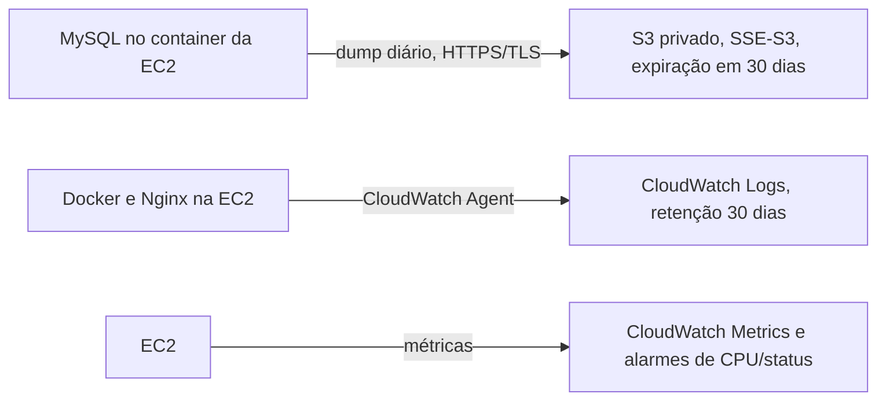

# ☁️ AWS Production Readiness — Conciliação Bancária

**Projeto Banco · Ticket 37060 · Agiw Sistemas**

> Este documento cobre **todos os requisitos** do checklist de entrega do PI Computação em Nuvem,
> explicando o que foi implementado, as limitações do AWS Academy e como cada item seria
> tratado em uma conta AWS real de produção.

---

## Sumário

1. [Arquitetura na AWS](#1-arquitetura-na-aws)
2. [HTTPS](#2-https)
3. [Segurança e Secrets](#3-segurança-e-secrets)
4. [IAM — Laboratório vs. Produção](#4-iam--laboratório-vs-produção)
5. [CI/CD](#5-cicd)
6. [Logs e CloudWatch](#6-logs-e-cloudwatch)
7. [Monitoramento](#7-monitoramento)
8. [Backup e Restore](#8-backup-e-restore)
9. [Escalabilidade](#9-escalabilidade)
10. [Estratégia de Rollback](#10-estratégia-de-rollback)
11. [Custos Estimados](#11-custos-estimados)
12. [Diagrama de Arquitetura](#12-diagrama-de-arquitetura)
13. [Checklist de Entrega](#13-checklist-de-entrega)
14. [Limitações do AWS Academy vs. Produção](#14-limitações-do-aws-academy-vs-produção)

---

## 1. Arquitetura na AWS

### O que foi implantado (AWS Academy)

```
Internet
    │
    ▼
EC2 t3.small (Amazon Linux 2023)
    ├── Nginx (porta 80 → proxy reverso)
    │       └── Next.js (porta 3000) ← app principal
    └── MySQL 8.0 (container Docker, porta 3306 interna)
```

**Serviços AWS utilizados e justificativa:**

| Serviço | Uso | Justificativa |
|---|---|---|
| **EC2 t3.small** | Executa app + MySQL | Suficiente para o módulo. 2 vCPU / 2 GiB RAM suporta Next.js + MySQL sem folga mínima. |
| **Elastic IP** | IP fixo para a instância | Sem EIP, o IP público muda toda vez que o Learner Lab reinicia a EC2 — inviabilizaria acesso consistente. |
| **Security Group** | Firewall da instância | Portas 80/443 públicas; 3000 e MySQL 3306 não expostos. SSH 22 está aberto publicamente no laboratório e deve ser limitado ao IP administrativo em produção. |
| **CloudWatch Logs** | Logs da aplicação | Coleta logs do Docker via agent. |
| **CloudWatch Metrics** | Monitoramento | CPU, memória, disco da EC2 + métricas customizadas. |
| **Amazon S3** | Backups MySQL | Cópia fora da EC2, bucket privado, SSE-S3, exigência de TLS e expiração em 30 dias. Cada conta mantém bucket próprio. |
| **IAM Instance Profile** | Permissões AWS da EC2 | `LabInstanceProfile`/`LabRole` no ambiente de referência; em contas comuns, role mínima para S3 e CloudWatch Agent. |

### Arquitetura ideal em produção

```
Internet
    │
    ▼ HTTPS (certificado ACM)
Application Load Balancer
    │  ← Health check: GET /api/health
    ▼
Auto Scaling Group
    ├── EC2 #1 (Next.js)  ┐
    ├── EC2 #2 (Next.js)  ├─── Amazon RDS MySQL Multi-AZ
    └── EC2 #3 (Next.js)  ┘
                │
         Amazon S3 (certificados mTLS, backups SQL)
                │
         AWS Secrets Manager (credenciais)
                │
         CloudWatch Logs + Alarms + Dashboard
```

---

## 2. HTTPS

### No AWS Academy

O AWS Academy **não permite criar certificados ACM** (Certificate Manager) de forma simples, pois isso exige validação de domínio. A solução adotada é:

1. **Nginx na EC2** expõe a porta 80 (HTTP), fazendo proxy reverso para o Next.js na porta 3000.
2. **HTTPS no laboratório** usa certificado **autoassinado**, gerado automaticamente por `infra/setup-ec2.sh` (e pelo UserData do CloudFormation). O Nginx escuta **80** (health check / CD) e **443**.

O navegador mostra aviso de certificado — esperado no AWS Academy, que não valida domínio no ACM. Em produção isso nunca seria usado.

```bash
# Já é feito pelo setup. Para regerar:
sudo openssl req -x509 -nodes -days 365 \
  -newkey rsa:2048 \
  -keyout /etc/ssl/private/conciliacao.key \
  -out /etc/ssl/certs/conciliacao.crt \
  -subj "/CN=conciliacao-agiw/O=Agiw Sistemas"
sudo cp infra/nginx.conf /etc/nginx/conf.d/conciliacao.conf
sudo nginx -t && sudo systemctl reload nginx
```

### Em produção real

```
ACM (AWS Certificate Manager)
    ↓ provisiona certificado TLS válido e gerenciado
Application Load Balancer
    ↓ HTTPS na porta 443 (certificado do ACM)
EC2 (HTTP interno 80 apenas)
```

- O ALB termina o TLS. A EC2 **nunca** precisa gerenciar certificados.
- Certificados do ACM **renovam automaticamente** — sem expiração manual.
- O endpoint HTTPS do ALB é aceito como HTTPS válido para o PI.

---

## 3. Segurança e Secrets

### O que está protegido

| Item | Como está protegido |
|---|---|
| `.env` | Listado no `.gitignore` e `.dockerignore` — nunca vai ao repositório nem à imagem |
| Certificados mTLS (`*.crt`, `*.key`) | Excluídos do Git e do Docker. Entram na EC2 via `scp`, montados como volume `:ro` |
| Credenciais bancárias | Só existem no `.env` do servidor. Nunca chegam ao browser. |
| Senha do MySQL | Variável de ambiente no `.env`. Não tem default hardcoded em produção. |
| Porta 3306 | Nunca exposta no Security Group. |

### Verificação automatizada

O workflow de CI (`ci.yml`) falha se encontrar `.env` versionado ou alguns padrões de credenciais hardcoded em `src/`. É uma proteção heurística, não um scanner completo nem uma auditoria do histórico Git; proteção de merge também depende de regras de branch no GitHub.

```yaml
- name: Verificar ausência de credenciais no repositório
  run: |
    if git ls-files --error-unmatch .env 2>/dev/null; then
      echo "❌ FALHA DE SEGURANÇA: arquivo .env está versionado!"
      exit 1
    fi
```

### Evolução proposta: AWS Secrets Manager (não integrado ao código atual)

O exemplo abaixo é uma configuração-alvo. Hoje a aplicação lê credenciais de variáveis de ambiente; não consulta Secrets Manager pelo SDK. `.env.prod.example` é apenas um modelo de nomes/valores vazios. Antes de afirmar que os secrets são carregados do Secrets Manager, é necessário implementar e validar essa integração ou configurar um mecanismo externo seguro para injetar as variáveis no processo.

```bash
# Criar secret no Secrets Manager
aws secretsmanager create-secret \
  --name "conciliacao-agiw/prod" \
  --secret-string '{
    "MYSQL_PASSWORD": "...",
    "BRADESCO_CLIENT_SECRET": "...",
    "SAFRA_PASSWORD": "..."
  }'

# Na aplicação, usar o SDK da AWS para buscar os secrets:
# import { SecretsManagerClient, GetSecretValueCommand } from "@aws-sdk/client-secrets-manager"
```

No desenho futuro, a aplicação não receberia credenciais persistidas em `.env`: seria necessário implementar a leitura via SDK do Secrets Manager ou usar um mecanismo de injeção seguro no runtime. A role teria apenas leitura nos secrets específicos. Isso ainda não está implementado neste projeto.

---

## 4. IAM — Laboratório vs. Produção

### No AWS Academy

O Learner Lab **não permite criar IAM Users, Roles ou Policies**. A única Role disponível é a `LabRole`, que tem permissões amplas.

```
Aplicação (EC2)
    ↓
LabRole (gerenciada pelo lab — permissões amplas)
    ↓
Qualquer serviço AWS
```

> Limitação aceita: documentar o que seria feito em produção.

### Em produção real: Princípio do Least Privilege

```
Aplicação (EC2)
    ↓
Role: role-conciliacao-app
    ↓ (permissões mínimas necessárias)
    ├── secretsmanager:GetSecretValue  → secret/conciliacao-agiw/*
    ├── logs:CreateLogGroup            → /aws/conciliacao-agiw/*
    ├── logs:CreateLogStream           → /aws/conciliacao-agiw/*
    ├── logs:PutLogEvents              → /aws/conciliacao-agiw/*
    └── cloudwatch:PutMetricData       → namespace ConciliacaoBancaria
```

**Permissões necessárias à instância e aos agentes (alvo de produção):**

| Permissão | Serviço | Motivo |
|---|---|---|
| `secretsmanager:GetSecretValue` | Secrets Manager | Ler credenciais bancárias e do banco |
| Permissões de escrita em streams específicas | CloudWatch Logs | CloudWatch Agent envia logs de Docker, Nginx e backup |
| `cloudwatch:PutMetricData` | CloudWatch | CloudWatch Agent publica CPU/memória/disco customizados |
| `s3:PutObject` (prefixo `mysql/`) | S3 | Upload dos backups SQL |
| `s3:GetObject` (prefixo `mysql/`) | S3 | Restore de backup; certificados mTLS são enviados por SCP no fluxo atual |

**O que a aplicação NÃO precisa:**

- Acesso a EC2 (a própria instância não precisa gerenciar outras)
- Acesso a IAM (nunca)
- Acesso a RDS via API (conecta diretamente via TCP/MySQL)
- Acesso a recursos de outras contas

---

## 5. CI/CD

### Continuous Integration (CI)

**Arquivo:** [`.github/workflows/ci.yml`](../.github/workflows/ci.yml)

**Fluxo:**

```
Push em qualquer branch / PR para main
    ↓
GitHub Actions (ubuntu-latest)
    ↓
npm ci (instala dependências com lockfile)
    ↓
npm run lint (ESLint — bloqueia código com erros)
    ↓
npm run build (Next.js standalone — BUILD_STANDALONE=1)
    ↓
Verifica artefato .next/standalone/server.js
    ↓
docker build (valida Dockerfile sem push)
    ↓
Verifica ausência de credenciais no código
```

### Continuous Deployment (CD)

**Arquivo:** [`.github/workflows/cd.yml`](../.github/workflows/cd.yml)

**Disparadores atuais:** push para `main` ou `projeto-nuvem-glauco`, ou execução manual (`workflow_dispatch`). Cada execução usa um único host/chave e faz deploy em um destino. Para configurar ou operar a implantação, consulte o [guia AWS](DEPLOY-AWS.md).

**Fluxo:**

```
Push em `main`/`projeto-nuvem-glauco` ou execução manual
    ↓
GitHub Actions
    ↓
Repete CI (lint + build)
    ↓
SSH na EC2 (via secret EC2_SSH_KEY)
    ↓
git fetch e reset para a branch disparada
    ↓
docker compose up -d --build --remove-orphans
    ↓
Health check interno: GET http://localhost:3000/api/health
    ↓
Health check externo: GET http://<EC2_HOST> (aceita 200/301/302)
    ↓
docker image prune (limpeza de imagens antigas)
```

O health check externo é informativo: mesmo após esgotar tentativas, o passo termina com sucesso. O health check interno em `localhost:3000/api/health` é o que falha o deploy.

### Secrets necessários no GitHub

Configurar em **Settings → Secrets and variables → Actions**. `EC2_SSH_KEY` deve ser secret; host, usuário e diretório podem ser secrets ou variables:

| Secret | Valor |
|---|---|
| `EC2_HOST` | IP público ou DNS da única instância alvo (secret ou variable) |
| `EC2_USER` | `ec2-user` (secret ou variable) |
| `EC2_SSH_KEY` | Conteúdo completo do arquivo `.pem` |
| `EC2_APP_DIR` | `/home/ec2-user/conciliacao-agiw` (secret ou variable) |

### Limitação do AWS Academy para CD

As credenciais AWS (`aws_access_key_id`, `aws_secret_access_key`, `aws_session_token`) **expiram a cada sessão (~4h)**. Por isso, o deploy não usa AWS CLI.

**Estratégia adotada:** Deploy via SSH + `git pull` + `docker compose`.

**Em produção real:**

```
GitHub Actions
    ↓ aws ecr get-login-password (credenciais permanentes via OIDC)
Amazon ECR (repositório de imagens Docker)
    ↓ push da nova imagem
Amazon ECS (Elastic Container Service)
    ↓ rolling update automático (sem downtime)
    ├── Drena requisições das tarefas antigas
    ├── Sobe tarefas com a nova imagem
    └── Drena e termina as antigas após health check passar
```

---

## 6. Logs e CloudWatch

**Estado verificado na EC2 de referência i-011e7c2ecaed16641 (us-east-1):** perfil LabInstanceProfile com role LabRole associado; agente CloudWatch ativo; grupos `/aws/conciliacao-agiw/app`, `nginx-access`, `nginx-error` e `backup` configurados; métricas de memória/disco publicadas; alarmes de CPU/status em OK. Os alarmes não têm ação SNS/e-mail. Após provisionar outro ambiente, valide os grupos, métricas e alarmes dessa instância.


### Logs da aplicação

O Next.js escreve no stdout/stderr, que o Docker captura. Para enviar ao CloudWatch, instale o **CloudWatch Logs Agent** na EC2:

```bash
# Instalar CloudWatch Agent (Amazon Linux 2023)
sudo dnf install -y amazon-cloudwatch-agent

# Configurar
sudo tee /opt/aws/amazon-cloudwatch-agent/etc/amazon-cloudwatch-agent.json > /dev/null << 'JSON'
{
  "logs": {
    "logs_collected": {
      "files": {
        "collect_list": [
          {
            "file_path": "/var/lib/docker/containers/*/*.log",
            "log_group_name": "/aws/conciliacao-agiw/app",
            "log_stream_name": "{instance_id}",
            "timestamp_format": "%Y-%m-%dT%H:%M:%S"
          },
          {
            "file_path": "/var/log/nginx/conciliacao_access.log",
            "log_group_name": "/aws/conciliacao-agiw/nginx-access",
            "log_stream_name": "{instance_id}"
          },
          {
            "file_path": "/var/log/nginx/conciliacao_error.log",
            "log_group_name": "/aws/conciliacao-agiw/nginx-error",
            "log_stream_name": "{instance_id}"
          },
          {
            "file_path": "/var/log/backup-conciliacao.log",
            "log_group_name": "/aws/conciliacao-agiw/backup",
            "log_stream_name": "{instance_id}"
          }
        ]
      }
    }
  }
}
JSON

# Iniciar o agent
sudo /opt/aws/amazon-cloudwatch-agent/bin/amazon-cloudwatch-agent-ctl \
  -a fetch-config \
  -m ec2 \
  -c file:/opt/aws/amazon-cloudwatch-agent/etc/amazon-cloudwatch-agent.json \
  -s
```

### Padrões de log implementados

A aplicação usa os seguintes prefixos nos logs (compatíveis com CloudWatch Insights):

```
[INFO]  Operação realizada com sucesso
[WARN]  Situação inesperada — sem impacto ao usuário
[ERROR] Falha ao processar operação
```

### O que NUNCA é logado

- Senhas, tokens, session keys
- Credenciais das APIs bancárias
- Chaves de certificado (apenas o caminho do arquivo)
- Dados financeiros completos (apenas identificadores)

### CloudWatch Logs Insights — Queries úteis

```sql
-- Erros das últimas 24h
fields @timestamp, @message
| filter @message like /ERROR/
| sort @timestamp desc
| limit 100

-- Requisições lentas (latência > 2s no Nginx)
fields @timestamp, @message
| filter @message like /request_time/ and @message > "2.000"
| sort @timestamp desc

-- Falhas de integração bancária
fields @timestamp, @message
| filter @message like /provider/ and @message like /erro/
| sort @timestamp desc
```

---

## 7. Monitoramento

### Métricas do CloudWatch (EC2)

| Métrica | Limiar de Alarme | Ação |
|---|---|---|
| `CPUUtilization` | > 80% por 5 min | Notificação SNS |
| `NetworkIn` | Queda > 90% | Possível instância inacessível |
| `StatusCheckFailed` | > 0 | Instância com problema de hardware/software |
| `DiskSpaceUtilization` | > 85% | Limpar logs ou ampliar volume |

### Health check da aplicação

O endpoint `/api/health` retorna:

```json
{
  "status": "healthy",
  "timestamp": "2026-10-10T18:00:00.000Z",
  "versao": "2.0.0",
  "ambiente": "production",
  "servicos": {
    "banco": {
      "ok": true,
      "latenciaMs": 12
    }
  },
  "uptimeSegundos": 86400
}
```

### Verificação manual da saúde

```bash
# Health check da app
curl -k https://<EC2-IP>/api/health | jq .

# Logs em tempo real
docker compose logs -f app

# Uso de recursos dos containers
docker stats

# Status do Nginx
sudo systemctl status nginx

# Espaço em disco
df -h
```

### Dashboard CloudWatch (em produção)

Em produção, criar um **CloudWatch Dashboard** com:
- Gráfico de CPU da EC2 (ou tarefas ECS)
- Gráfico de requisições HTTP (erros 4xx e 5xx via Nginx)
- Alarme de health check
- Latência do banco de dados
- Taxa de erros por banco integrado (Bradesco, Safra)

---

## 8. Backup e Restore

### Backup — Estratégia Implementada

#### Backup diário automático (MySQL em contêiner)

O cron `/etc/cron.d/conciliacao-backup` executa diariamente `infra/backup-conciliacao.sh`. O script gera um dump consistente do MySQL, valida o gzip e envia o arquivo para o S3 antes de remover arquivos locais antigos.

- Bucket da implantação de referência: `conciliacao-334393066436-backup-i011e7c2ecaed16641` (us-east-1), privado e com bloqueio de acesso público. O guia AWS explica como definir o bucket do ambiente.
- Criptografia no S3: SSE-S3 (AES256); política do bucket exige HTTPS.
- Retenção: 30 dias no S3 e 14 dias no volume local da EC2.
- Chave S3: `mysql/conciliacao_AAAA-MM-DD_HHMMSS.sql.gz` (timestamp UTC).
- O perfil da EC2 fornece acesso ao bucket; não há access key AWS no script ou no `.env`.

#### Backup manual

Use o mesmo script da rotina automática para validar e enviar o dump ao S3:

```bash
sudo env BACKUP_S3_BUCKET=<BUCKET-DA-CONTA> AWS_REGION=us-east-1 /usr/local/bin/backup-conciliacao.sh
aws s3 ls s3://<BUCKET-DA-CONTA>/mysql/ --region us-east-1
```

### Restore

O script [`infra/restore-conciliacao.sh`](../infra/restore-conciliacao.sh) aceita um arquivo local ou um URI S3. Ele para a aplicação, importa o dump no banco configurado e a inicia novamente; isso substitui os dados atuais. O [guia AWS](DEPLOY-AWS.md) documenta como ensaiar em schema temporário antes de restaurar o banco real.

```bash
cd /home/ec2-user/conciliacao-agiw
sudo bash infra/restore-conciliacao.sh s3://<BUCKET-DA-CONTA>/mysql/<arquivo>.sql.gz
```

O script baixa o objeto usando o Instance Profile, para a aplicação, importa o dump e sobe a aplicação novamente. Em 15/11/2026, validamos o objeto do S3 importando-o em um schema temporário: 8 tabelas foram restauradas e o banco principal não foi alterado.

### Em produção real: RDS com backups automáticos

Com **Amazon RDS**:
- **Backups automáticos:** retendo 7–35 dias, configurável
- **Point-in-Time Recovery (PITR):** restaurar para qualquer segundo dentro do período de retenção
- **Multi-AZ:** failover automático para réplica em outra zona em caso de falha
- **Snapshots manuais:** antes de mudanças críticas de schema

```bash
# Restaurar RDS para um ponto no tempo
aws rds restore-db-instance-to-point-in-time \
  --source-db-instance-identifier conciliacao-db \
  --target-db-instance-identifier conciliacao-db-restored \
  --restore-time 2026-10-10T02:00:00Z
```

---

## 9. Escalabilidade

### Situação atual (AWS Academy)

A aplicação roda em uma única instância EC2 `t3.small`. **Não escala automaticamente.**

**Limitações:**
- Um único ponto de falha
- Capacidade máxima ~50 usuários simultâneos (estimativa conservadora)
- Escalar exige intervenção manual (trocar tipo de instância)

### Análise de escalabilidade — o que mudaria com crescimento

#### Gargalo 1: Aplicação Next.js

A aplicação é stateless — não armazena sessão no servidor. Isso significa que pode escalar horizontalmente sem mudanças de código.

```
Adicionar réplicas:
  Auto Scaling Group
    ├── EC2 #1 (Next.js)
    ├── EC2 #2 (Next.js)  ← novas instâncias adicionadas automaticamente
    └── EC2 #3 (Next.js)
```

**Configuração de Auto Scaling em produção:**
- Política: escalar quando CPU > 70% por 3 minutos
- Mínimo: 2 instâncias (alta disponibilidade)
- Máximo: 10 instâncias
- Health check: endpoint `/api/health`

#### Gargalo 2: Banco de dados MySQL

MySQL em contêiner **não escala horizontalmente** sem mudanças. A solução progressiva seria:

| Fase | Solução | Custo adicional |
|---|---|---|
| Curto prazo | `t3.small` (atual) | Sem custo adicional |
| Médio prazo | Migrar para RDS `db.t3.small` + réplica de leitura | ~$25/mês |
| Longo prazo | RDS Multi-AZ `db.r6g.large` | ~$150/mês |

#### Gargalo 3: Importação de extratos bancários

A importação de extratos (especialmente OFX grandes) é síncrona. Com escala, mover para processamento assíncrono:

```
Upload extrato → SQS → Lambda/Worker → MySQL → Notificação
```

### Resumo: o que o código já faz de correto para escala

- ✅ Aplicação stateless (sem sessão no servidor)
- ✅ Pool de conexões MySQL (não abre conexão a cada request)
- ✅ Imagem Docker pronta para múltiplas instâncias
- ✅ Variáveis de ambiente para configuração por ambiente
- ✅ Health check endpoint para ALB

---

## 10. Estratégia de Rollback

### Rollback no AWS Academy (via Git + Docker)

#### Comportamento do workflow quando o deploy falha

Falha de build/lint impede o deploy. Depois que o deploy SSH começa, não há rollback automático: o Compose pode já ter substituído os containers e o schema pode ter sido alterado. O health check local falha o job, mas não restaura os containers anteriores; o health check externo é informativo.

```
Push em uma branch configurada / execução manual
    ↓
GitHub Actions: build + lint
    ↓ FALHA → deploy não começa; versão atual permanece
    ↓ SUCESSO
Deploy via SSH
    ↓
Health check interno falha
    ↓
Job marcado como falho no GitHub Actions
    ↓ exige inspeção e, se necessário, rollback manual
```

#### Rollback manual (versão anterior funcionando mas com bug)

```bash
# Na EC2, verificar o histórico de commits deployados
cd /home/ec2-user/conciliacao-agiw
git log --oneline -10

# Voltar para o commit anterior
git checkout <COMMIT_HASH_ANTERIOR>

# Reconstruir e subir
docker compose up -d --build

# Verificar
curl -f http://localhost:3000/api/health

# Não faça commits diretamente no checkout de produção.
```

#### Rollback para backup do banco

Se o rollback de código precisar ser acompanhado de rollback de dados:

```bash
# 1. Parar app
docker compose stop app

# 2. Restaura o backup escolhido. Esta operação SUBSTITUI os dados atuais.
sudo bash infra/restore-conciliacao.sh s3://<BUCKET-DA-CONTA>/mysql/<ARQUIVO.sql.gz>

# 3. Fazer rollback do código
git checkout <COMMIT_ANTERIOR>

# 4. Reconstruir e subir
docker compose up -d --build

# 5. Verificar
docker compose logs -f app
```

### Em produção real: Blue/Green Deployment

```
                    ┌─── Blue (versão atual — 100% do tráfego)
ALB ───────────────►│
                    └─── Green (nova versão — 0% do tráfego)

Deploy:
  1. Subir nova versão no ambiente Green
  2. Rodar testes de fumaça no Green
  3. ALB: desviar 10% do tráfego para Green
  4. Monitorar erros por 5 min
  5. ALB: 100% para Green
  6. Blue fica de "standby" por 30 min

Rollback (se algo der errado):
  ALB: 100% para Blue (< 30 segundos)
```

---

## 11. Custos Estimados

### AWS Academy (sem cobrança real)

O Learner Lab fornece créditos — não há cobrança real. As estimativas abaixo servem para referência de produção.

### Estimativa para produção (conta real, região us-east-1)

#### Configuração mínima (1 instância, banco em contêiner)

| Recurso | Especificação | Custo/mês |
|---|---|---|
| EC2 `t3.small` | 730h/mês (On-Demand) | ~$15,18 |
| Elastic IP | IP associado a instância ativa | $0,00 |
| Volume EBS `gp3` 20 GiB | Armazenamento da instância | ~$1,60 |
| Transfer de dados | 10 GB saída estimada | ~$0,90 |
| CloudWatch Logs | 5 GB ingestão/mês | ~$2,50 |
| Amazon S3 Standard (backup) | 30 backups diários retidos por 30 dias; tamanho observado ~2,9 KB por arquivo | <$0,01 |
| **TOTAL** | | **~$20/mês** |

**Estimativa do backup S3:** os arquivos compactados atuais têm aproximadamente 2,9 KB. Com um backup diário e retenção de 30 dias, são cerca de 87 KB armazenados; armazenamento e 30 gravações mensais ficam abaixo de US$ 0,01/mês. Para dimensionamento, se o banco crescer para 100 MB por backup diário, 30 cópias representam aproximadamente 3 GB-mês, cerca de US$ 0,07/mês de armazenamento S3 Standard, mais menos de US$ 0,001 em gravações e uma restauração pontual. A estimativa usa US$ 0,023/GB-mês e US$ 0,005 por 1.000 gravações; transferência de saída, impostos, crescimento e solicitações adicionais podem alterar a fatura. A AWS cobra armazenamento, solicitações e transferência conforme o uso; consulte a [página oficial de preços do S3](https://aws.amazon.com/s3/pricing/) antes de provisionar.

#### Configuração recomendada para produção (alta disponibilidade)

| Recurso | Especificação | Custo/mês |
|---|---|---|
| EC2 `t3.small` × 2 (ASG min) | 2 × $15,18 | ~$30,36 |
| Application Load Balancer | 1 ALB + 700h ativas | ~$20,00 |
| RDS MySQL `db.t3.micro` Multi-AZ | Banco gerenciado com failover | ~$28,80 |
| Volume EBS `gp3` 20 GiB × 2 | App nodes | ~$3,20 |
| RDS Storage 20 GiB | Banco | ~$2,30 |
| ACM (certificado TLS) | Incluído no ALB | $0,00 |
| CloudWatch Logs (10 GB/mês) | | ~$5,00 |
| CloudWatch Alarms (5 alarmes) | | ~$0,50 |
| Transfer de dados (20 GB/mês) | | ~$1,80 |
| **TOTAL** | | **~$92/mês** |

#### Otimizações para reduzir custo

- **Reserved Instances** (1 ano): reduz EC2 em ~40% → EC2 `t3.small` cai de $15 para ~$9/mês
- **Savings Plans**: alternativa mais flexível às RIs
- **RDS em Single-AZ** (sem alta disponibilidade): `db.t3.micro` cai de $28 para ~$15/mês
- **Scheduled scaling**: desligar instâncias fora do horário comercial (18h–8h) → economia de ~60%

---

## 12. Diagrama de Arquitetura

### AWS Academy (implementado)

```
┌─────────────────────────────────────────────────────────────┐
│                      AWS Academy Lab                        │
│                      (us-east-1)                            │
│                                                             │
│  ┌──────────────────────────────────────────────────────┐   │
│  │  EC2 t3.small — conciliacao-agiw                     │   │
│  │  Amazon Linux 2023                                   │   │
│  │                                                      │   │
│  │  ┌──────────────────────────────────────────────┐   │   │
│  │  │  Docker Compose                              │   │   │
│  │  │                                              │   │   │
│  │  │  ┌────────────┐    ┌────────────────────┐   │   │   │
│  │  │  │   Nginx    │    │   Next.js app      │   │   │   │
│  │  │  │  :80/:443  │───►│   :3000            │   │   │   │
│  │  │  │            │    │   (standalone)     │   │   │   │
│  │  │  └────────────┘    └────────┬───────────┘   │   │   │
│  │  │                             │               │   │   │
│  │  │                   ┌─────────▼──────────┐   │   │   │
│  │  │                   │  MySQL 8.0         │   │   │   │
│  │  │                   │  :3306 (interno)   │   │   │   │
│  │  │                   │  volume: dados-    │   │   │   │
│  │  │                   │  mysql             │   │   │   │
│  │  │                   └────────────────────┘   │   │   │
│  │  └──────────────────────────────────────────────┘   │   │
│  │                                                      │   │
│  │  Security Group: sg-conciliacao-agiw                 │   │
│  │    IN: 22 (SSH), 80 (HTTP), 443 (HTTPS)             │   │
│  │    OUT: all                                          │   │
│  └──────────────────────────────────────────────────────┘   │
│                                │                            │
│  Elastic IP ───────────────────┘                            │
│                                                             │
│  CloudWatch Logs: /aws/conciliacao-agiw/*                   │
└─────────────────────────────────────────────────────────────┘
                      │
              Internet │ (HTTP/HTTPS)
                      │
               Usuário / Equipe
```

Fluxos AWS adicionais da implantação atual:



Na instância de referência, o Security Group tem 22, 80 e 443 liberadas; a regra SSH atual está pública e é um débito de segurança do laboratório. O template exige `AllowedSSHCidr`; o guia AWS orienta limitar a origem SSH ao IP administrativo (`/32`). As portas 3000 e 3306 não são entradas públicas.

### Produção (conta real)

```
┌─────────────────────────────────────────────────────────────────────────────┐
│                            AWS — us-east-1                                  │
│                                                                             │
│  Route 53 (DNS) ──► ACM (certificado TLS)                                   │
│                           │                                                 │
│  ┌────────────────────────▼────────────────────────────────────────────┐    │
│  │           Application Load Balancer (ALB)                           │    │
│  │                HTTPS :443 → HTTP :80 (EC2s)                        │    │
│  └────────┬────────────────────────────────────────────┬──────────────┘    │
│           │                                            │                   │
│  ┌────────▼────────────────────────────────────────────▼──────────┐        │
│  │                   Auto Scaling Group                            │        │
│  │                                                                 │        │
│  │  ┌──────────────────┐          ┌──────────────────┐            │        │
│  │  │  EC2 t3.small    │          │  EC2 t3.small    │            │        │
│  │  │  (Next.js)       │          │  (Next.js)       │ ...        │        │
│  │  └──────────────────┘          └──────────────────┘            │        │
│  └─────────────────────────────────────────────────────────────────┘        │
│                              │                                              │
│  ┌───────────────────────────▼──────────────────────────────────────────┐   │
│  │               Amazon RDS MySQL 8.0 (Multi-AZ)                        │   │
│  │  Primary (us-east-1a) ←── Replicação ──► Standby (us-east-1b)       │   │
│  └───────────────────────────────────────────────────────────────────────┘   │
│                                                                              │
│  AWS Secrets Manager  ←── credenciais bancárias e do banco                   │
│  Amazon S3            ←── certificados mTLS, backups SQL                     │
│  CloudWatch Logs      ←── logs app + nginx                                   │
│  CloudWatch Alarms    ←── CPU, erros HTTP, health check                      │
│  CloudWatch Dashboard ←── painel de monitoramento                            │
└─────────────────────────────────────────────────────────────────────────────┘
```

---

## 13. Checklist de Entrega

| Item | Status | Onde |
|---|---|---|
| ✅ Aplicação funcionando na AWS | Lab: após `setup-ec2.sh` + `.env` + `docker compose up` | EC2 via `docker compose up -d --build` |
| HTTPS habilitado | Ativo na EC2 com certificado autoassinado; valide `https://<ELASTIC-IP>/api/health` (aviso do navegador esperado) | `infra/nginx.conf`; porta 443 |
| ✅ Código no GitHub | Implementado | `.gitignore` correto; `.env` e certs excluídos |
| Nenhuma credencial no repositório | `.env` e certificados ignorados; CI faz verificações heurísticas, não auditoria completa do histórico Git | `.gitignore`, `.dockerignore`, CI |
| ✅ CI funcionando | Implementado | `.github/workflows/ci.yml` |
| CD implementado/documentado | Workflow deploya no host configurado; o guia AWS documenta operação e atualização | `.github/workflows/cd.yml`; [guia AWS](DEPLOY-AWS.md) |
| Logs disponíveis | Docker, Nginx e CloudWatch; grupos configurados com retenção de 30 dias | `docker compose logs`; `/var/log/nginx`; seção 6 |
| CloudWatch utilizado | Verificado em 15/11/2026: agente via LabInstanceProfile/LabRole; logs app, Nginx e backup; métricas de memória/disco e alarmes CPU/status em OK | Região us-east-1; infra/cloudwatch-agent.json; EC2 i-011e7c2ecaed16641 |
| Backup definido | Ativo na implantação de referência: dump diário enviado ao S3, SSE-S3, acesso público bloqueado, TLS obrigatório; 30 dias no S3 e 14 dias local | bucket da implantação de referência; [guia AWS](DEPLOY-AWS.md) |
| Restore definido | Restore do objeto S3 testado em schema temporário (8 tabelas); banco principal preservado; script também aceita URI S3 | `infra/restore-conciliacao.sh` |
| ✅ Diagrama AWS | Implementado | Seção 12 deste documento |
| ✅ Serviços AWS justificados | Documentado | Seção 1 deste documento |
| ✅ Configuração preparada para ambientes | Implementado | `.env.example` + variáveis de ambiente |
| Estrategia de rollback | Procedimento manual documentado; nao automatizado | Secao 10 |
| ✅ Escalabilidade analisada | Documentado | Seção 9 deste documento |
| ✅ Custo estimado | Documentado | Seção 11 deste documento |
| ✅ README completo | Implementado | `README.md` |
| ✅ Limitações do AWS Academy documentadas | Documentado | Seção 14 deste documento |
| ✅ Diferenças para produção documentadas | Documentado | Ao longo de todas as seções |

---

## 14. Limitações do AWS Academy vs. Produção

| Limitação | Como funciona no AWS Academy | Como seria em produção |
|---|---|---|
| **Credenciais AWS expiram (~4h)** | Pegar no botão "AWS Details" a cada sessão | OIDC do GitHub Actions + Roles sem credenciais de longa duração |
| **IAM: só LabRole** | Usar LabRole para tudo | Role específica com Least Privilege por serviço |
| **Sem ACM** | Certificado auto-assinado no Nginx | ACM gerenciado + renovação automática via ALB |
| **Sem Route 53** | IP público direto (ou DNS do EC2) | Domínio próprio registrado no Route 53 |
| **Sessão expira, EC2 desliga** | `restart: unless-stopped` para religar tudo ao iniciar | ECS Fargate (serverless) ou ASG — nunca desligam |
| **RDS pode estar bloqueado** | MySQL em contêiner Docker | RDS MySQL Multi-AZ com backups automáticos e PITR |
| **Secrets Manager pode não ter permissão** | `.env` no servidor (nunca no Git) | Secrets Manager + SDK da AWS + Role com GetSecretValue |
| **ECR pode não ter permissão** | Imagem construída diretamente na EC2 | Push para ECR + pull na EC2/ECS |
| **Sem WAF** | Security Group como firewall básico | AWS WAF na frente do ALB (proteção contra OWASP Top 10) |
| **Sem Auto Scaling** | Instância única t3.small | ASG com min=2, max=10, scale por CPU >70% |

---

## Respondendo às perguntas do PI

> **Nossa aplicação está funcionando na AWS?**
> Sim na conta de referência. EC2 t3.small com Docker Compose — app + MySQL. Acesse `https://<ELASTIC_IP>`; o certificado do laboratório é autoassinado.

> **Como identificamos erros?**
> `docker compose logs -f app`, CloudWatch Logs (`/aws/conciliacao-agiw/`), e o endpoint `/api/health`.

> **Como monitoramos a aplicação?**
> CloudWatch Metrics (CPU, memória, disco da EC2), health check automático no CD, e logs estruturados.

> **Como recuperamos dados?**
> Backup diário enviado ao S3, com cópia local em `/home/ec2-user/backups/`. Restore pelo script `infra/restore-conciliacao.sh`, usando arquivo local ou URI S3. Detalhes na Seção 8.

> **Como publicamos uma nova versão?**
> Push em `main`/`projeto-nuvem-glauco` ou execução manual dispara CD para o host configurado. O workflow não distribui para múltiplos hosts; operações e atualização estão no [guia AWS](DEPLOY-AWS.md).

> **Como voltamos para uma versão anterior?**
> `git checkout <commit>` + `docker compose up -d --build` na EC2. Detalhes na Seção 10.

> **O que acontece se o número de usuários crescer?**
> Curto prazo: escalar verticalmente a EC2. Médio/longo prazo: ASG + ALB + RDS Multi-AZ. A app é stateless e escala horizontalmente sem alterações de código. Detalhes na Seção 9.

> **Quanto a solução custaria?**
> ~$20/mês (config mínima) a ~$92/mês (alta disponibilidade). Detalhes na Seção 11.

> **O que precisaria mudar para colocá-la realmente em produção?**
> ALB + ACM (HTTPS confiável), RDS Multi-AZ (banco gerenciado), integração de carregamento de secrets pelo Secrets Manager ou injeção segura no runtime, ECR + ECS (deploys), WAF, ASG e Route 53. Parte é mudança de infraestrutura; o carregamento de secrets exige implementação ou configuração adicional, ainda não feita neste projeto.
